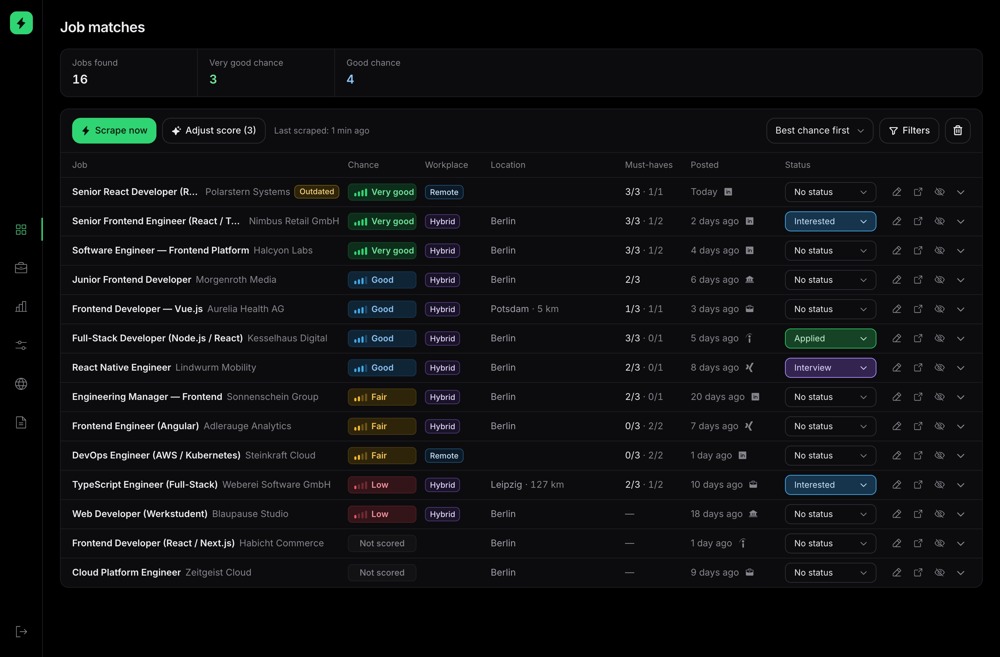
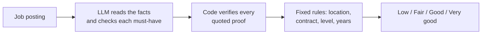

# 🔍 AI Job Hunter

[](https://github.com/lvfranek/ai-job-hunter/actions/workflows/ci.yml)

Scrapes five German job boards, rates your chance at every job with an LLM and writes a cover
letter for the ones you like. Works for any profession, not just software.



## Tech Stack

| Area     | Choice                                                                |
| -------- | --------------------------------------------------------------------- |
| Frontend | Next.js 16, React 19, TypeScript, Tailwind CSS 4                      |
| Database | Supabase (Postgres, RLS)                                              |
| Scraping | Apify (Indeed, LinkedIn, Xing, Stepstone, Arbeitsagentur)             |
| AI       | OpenRouter, `qwen3-next-80b-a3b-instruct`, answers validated with Zod |
| Quality  | Vitest (234 tests), GitHub Actions, an eval with the real model       |
| Hosting  | Vercel                                                                |

## How Scoring Works

Asked for a score, an LLM gives a different number every run. So here the model decides
nothing: it only reads the posting and fills in a checklist. Code makes the call.



If the model says you know Kubernetes, it has to quote the line in your profile that proves it.
Code checks that quote word for word, so an invented skill counts as missing.

## Evaluation

30 made-up postings with traps (a working-student job hidden in the text, home office mentioned
only at the very end), each scored 3 times by the real model.

| Right tier | Same tier in all 3 runs | Cost per job |
| ---------- | ----------------------- | ------------ |
| 98 %       | 93 %                    | $0.0004      |

What it found and how it works: [eval/README.md](eval/README.md).

## Features

- **One scan, five boards** — Indeed, LinkedIn, Xing, Stepstone and the Arbeitsagentur.
- **Chance tiers** — every job gets Low, Fair, Good or Very good, with the reasons on the card.
- **Work locations** — remote, or the cities you'd commute to, each with its own radius.
- **Cover letters** — one click writes a German or English letter, checked for invented claims, as a Word file.
- **CV import** — fills in your skills and contact details from a CV. The file isn't stored.
- **Application tracker** — every application in one list, added from the dashboard, by hand or from CSV.
- **Keyword stats** — shows which search keywords actually find jobs worth applying to.
- **Scheduled scans** — a cron endpoint scrapes and scores, then posts new good matches to a webhook.

## Live Demo

[ai-job-hunter-rosy.vercel.app](https://ai-job-hunter-rosy.vercel.app/): runs on sample data,
nothing you do is saved.

## ⚙️ Installation

**Prerequisites:** Node.js 20.9+, a [Supabase](https://supabase.com) project, and
[Apify](https://apify.com) and [OpenRouter](https://openrouter.ai) accounts for real scraping and
scoring.

1. Clone and install:

   ```bash
   git clone https://github.com/lvfranek/ai-job-hunter.git
   cd ai-job-hunter
   npm install
   ```

2. Run every file in `supabase/migrations/` in order (Supabase SQL editor or `supabase db push`).

3. Copy the env file and fill in your Supabase URL, service role key and login email:

   ```bash
   cp .env.local.example .env.local
   ```

4. Generate the two secrets and put them in `.env.local`:

   ```bash
   # CREDENTIALS_ENCRYPTION_KEY
   openssl rand -hex 32
   # AUTH_PASSWORD_HASH (your login password)
   node -e "const c=require('crypto');const s=c.randomBytes(16).toString('hex');c.scrypt(process.argv[1],s,64,(e,k)=>console.log(s+':'+k.toString('hex')))" "your-password"
   ```

5. Start the app, log in, and add your Apify and OpenRouter keys under Settings → API Keys:

   ```bash
   npm run dev
   ```

## Environment Variables

| Variable                     | Description                                 | Required           |
| ---------------------------- | ------------------------------------------- | ------------------ |
| `NEXT_PUBLIC_SUPABASE_URL`   | Supabase project URL                        | Yes                |
| `SUPABASE_SERVICE_ROLE_KEY`  | Supabase service role key (server only)     | Yes                |
| `AUTH_EMAIL`                 | Login email                                 | Yes                |
| `AUTH_PASSWORD_HASH`         | `salt:hash` of your password                | Yes                |
| `CREDENTIALS_ENCRYPTION_KEY` | Encrypts the API keys saved in Settings     | Yes                |
| `OPENROUTER_API_KEY`         | OpenRouter key                              | Or in Settings     |
| `APIFY_API_KEY`              | Apify token                                 | Or in Settings     |
| `APIFY_SCRAPER_*`            | Apify actor id per job board                | Or in Settings     |
| `CRON_SECRET`                | Bearer token for `POST /api/cron/scrape`    | For scheduled runs |
| `NOTIFICATION_WEBHOOK_URL`   | Gets new good matches after a scheduled run | No                 |

## Tests

```bash
npm test       # unit tests: tier rules, parsers, filters, CSV import, …
npm run eval   # the eval above, with the real model (~3 cents)
```

Unit tests, lint, typecheck and build run in CI on every push.

## Deployment

Connect the repo to Vercel and set the same env variables. Reuse the secrets you generated
locally: new ones lock you out and make saved API keys unreadable.

## Security Considerations

- One login (scrypt-hashed password, rate limited) protects every page and API route.
- All database access is server-side, and RLS is on for every table.
- API keys saved in Settings are encrypted with AES-256-GCM.
- CSP, HSTS and the other security headers are set in `next.config.ts`.

## Limitations

- Single user: no sign-up, the RLS policies are pinned to one user id.
- Scraping depends on third-party Apify actors. When a board changes, its results drop until the
  actor is fixed.
- Germany, Austria and Switzerland only (place data and prompts).

## License

MIT, see [LICENSE](LICENSE). The place data in `src/lib/geo/places-dach.json` comes from
[GeoNames](https://www.geonames.org) under CC BY 4.0.
